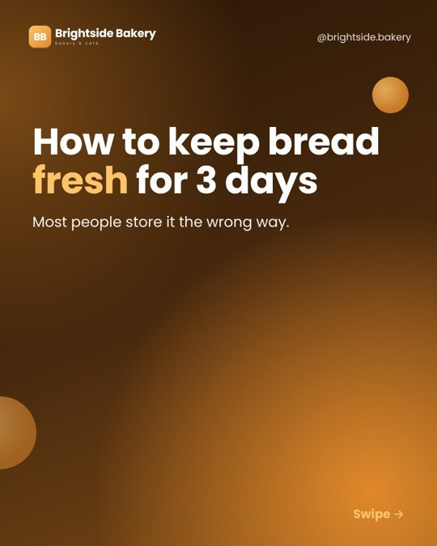
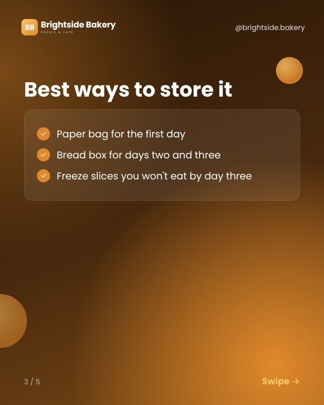
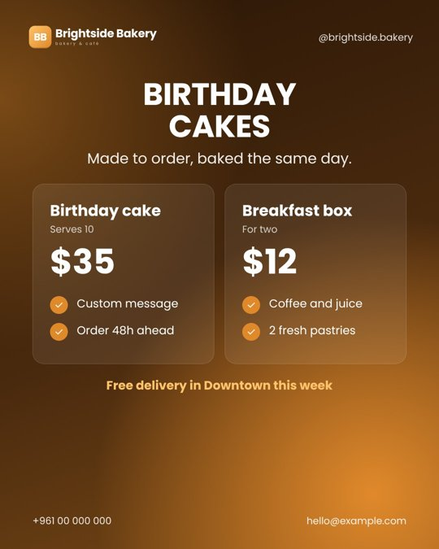
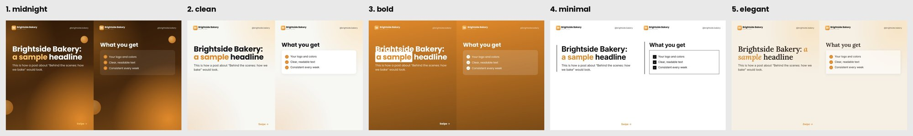

# Instagram Autopilot

A free Instagram manager for any business, run by Claude.

Tell it about your page once. Every week it plans, writes, designs and quality-checks your posts:
carousels, offer posts, and reels with a voiceover. Then it publishes them to Instagram on time,
by itself.

**Free:** no paid scheduler, no API bills. Publishing uses GitHub Actions + Meta's Instagram API.
Images and reels are hosted on GitHub Pages. Voiceovers use open-source Piper voices.

| Carousel | List slide | Offer | Reel |
|---|---|---|---|
|  |  |  |  |

*(Sample brand. Your posts use your logo, colors, topics and prices.)*

### 5 themes, in your colors



**midnight** (dark gradient) · **clean** (light and airy) · **bold** (solid brand color) ·
**minimal** (black and white) · **elegant** (cream and serif). The wizard shows all five in *your* logo
and colors so you can pick by eye. You can switch any time.

## Install (Claude)

Paste this into Claude:

```
Install the plugin from https://github.com/mohamad-alawieh/instagram-autopilot, then run its setup skill.
```

Or, in Claude Code:

```
/plugin install instagram-autopilot --marketplace mohamad-alawieh/instagram-autopilot
/instagram-autopilot:setup
```

On older versions of Claude Code: `/plugin marketplace add mohamad-alawieh/instagram-autopilot`, then
`/plugin install instagram-autopilot`.

## What the setup wizard does

1. **Asks about your page:** name and handle, what the business does and for whom, your offers and
   prices, contact details, tone, and the topics you want to post about.
2. **Logo and theme:** uses your logo, or creates a simple one, and picks brand colors from it. Then it
   shows all 5 themes in your brand and you choose the look.
3. **Schedule:** how many posts a week, which days, what time, which formats (carousel, single
   image, offer, reel), and which free voice reads the reels.
4. **Walks you through every connection step:** creating a GitHub account and your repo from this
   template, turning on GitHub Pages, creating a free Meta developer account and app, connecting your
   Instagram, and adding the token as a repo secret. There's no code to write and nothing to install.
5. **Runs a live test post**, makes your first week, turns on the weekly run, and confirms the schedule.

Prefer to do it by hand? Read **[guide/SETUP_GUIDE.md](guide/SETUP_GUIDE.md)**.

## Skills

| Command | What it does |
|---|---|
| `/instagram-autopilot:setup` | The onboarding wizard above |
| `/instagram-autopilot:weekly` | Plans, makes, checks and schedules next week's posts, and checks last week's went out |

## How it works

```
Claude (weekly)                 Your GitHub repo                      Instagram
───────────────                 ────────────────                      ─────────
plans topics from your  ──►  autopilot/schedule.json (queue)
pillars, writes copy,        docs/media/… (images, reels) ──► GitHub Pages (public links)
designs images & reels,                     │
runs quality checks          .github/workflows/instagram.yml
                             runs hourly ── publishes due posts ──────────────► your page
                             records them in autopilot/published.json
```

Every post goes through a quality gate ([autopilot/QUALITY.md](autopilot/QUALITY.md)) before it's queued:
- reel hooks are scored, and scripts are timed (hook under 3 seconds, no beat over 4 seconds);
- captions are linted: what shows before "… more", one call to action, at most 5 hashtags;
- text is cleaned of AI-sounding phrasing and scored for how human it reads.

Those checks come from [instagram-agent-skill](https://github.com/Jakeschincariol/instagram-agent-skill)
(MIT), vendored in `autopilot/ig-skills/`.

## Repo layout

| Path | What |
|---|---|
| `skills/` | The Claude plugin skills (setup, weekly) |
| `autopilot/brand.json` | Your brand (created by setup; see `brand.example.json`) |
| `autopilot/voice.md` | Your brand voice (created by setup) |
| `autopilot/schedule.json` · `published.json` · `history.md` | The queue, the posted log, and the topic history |
| `autopilot/render_post.py` | Designs carousels, single images and offers |
| `autopilot/make_reel.py` | Builds voiceover reels (free Piper voices) |
| `autopilot/make_logo.py` | Creates a logo, or picks colors from yours |
| `autopilot/preview_themes.py` | Shows all 5 themes in your brand side by side |
| `autopilot/publish.py` | Publishes to Instagram (run by GitHub Actions) |
| `autopilot/RUNBOOK.md` | Exactly what the weekly run does |
| `docs/media/` | Your images and reels, served by GitHub Pages |

## Limits

- It doesn't reply to comments or DMs.
- Reels are motion graphics with an AI voice, not filmed video. To use your own voice, record it and
  ask Claude to sync it.
- Posts go out within an hour after their scheduled time, because the workflow checks hourly.
- Instagram tokens last 60 days. The workflow renews them if you add the `GH_PAT` secret (setup step 5b).

## License

MIT. See [LICENSE](LICENSE). `autopilot/ig-skills/` is MIT © Jake Schincariol.
